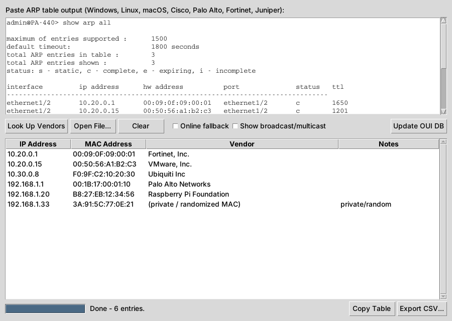

# ARP Vendor Lookup

[](https://github.com/romeoreynolds/arp-vendor-lookup/actions/workflows/tests.yml)


**Paste an ARP table from almost any device and get back a clean IP / MAC / vendor list.**
Built for network and security work: quick asset identification, spotting unknown or rogue
devices on a segment, and documenting what's plugged into a client network.



## Why this tool

- **Offline first, privacy aware.** Vendor names come from the official IEEE registries, downloaded
  once and cached locally. Your MAC addresses never leave your machine unless you opt in to the
  online fallback, and even then only the 3-byte vendor prefix (OUI) is sent, never the full MAC.
- **Works with real-world output.** No fixed column positions. It finds the IP and MAC on each line,
  so it handles every format below, skips headers and `(incomplete)` entries, and de-duplicates.
- **Flags what matters.** Broadcast, multicast and null entries are filtered out by default.
  Phones and laptops using **private / randomized MACs** are labeled instead of showing as "Unknown".
- **GUI and CLI.** Point-and-click for quick checks; pipe-friendly CLI with table, CSV and JSON
  output for scripts and reports.
- **Zero dependencies.** Python standard library only.

## Supported formats

| Platform | Command | MAC notation |
|---|---|---|
| Windows | `arp -a` | `aa-bb-cc-dd-ee-ff` |
| Linux | `arp -n`, `ip neigh`, `cat /proc/net/arp` | `aa:bb:cc:dd:ee:ff` |
| macOS | `arp -a` | `a:b:c:d:e:f` (leading zeros dropped) |
| Cisco IOS / NX-OS | `show ip arp` | `aabb.ccdd.eeff` |
| Palo Alto PAN-OS | `show arp all` | `aa:bb:cc:dd:ee:ff` |
| Fortinet FortiOS | `get system arp` | `aa:bb:cc:dd:ee:ff` |
| Juniper Junos | `show arp no-resolve` | `aa:bb:cc:dd:ee:ff` |

Example output for each is in [`samples/`](samples). Anything else with an IPv4 address and a MAC
on the same line will usually work too.

## Download (no Python needed)

Grab the app for your system from the **[latest release](https://github.com/romeoreynolds/arp-vendor-lookup/releases/latest)**.
The vendor database is built in, so it works offline right away.

| OS | File | First launch |
|---|---|---|
| Windows 10/11 | `ARP-Vendor-Lookup-windows.exe` | Double-click. If SmartScreen appears: **More info → Run anyway** |
| macOS (Apple Silicon) | `ARP-Vendor-Lookup-macos.zip` | Unzip, then **right-click the app → Open → Open** (only needed once) |
| Linux (x86_64) | `ARP-Vendor-Lookup-linux.tar.gz` | `tar xzf ARP-Vendor-Lookup-linux.tar.gz`, then double-click or run `./ARP-Vendor-Lookup-linux` |

The apps are unsigned, which is why Windows and macOS warn on first launch. Each release includes
`SHA256SUMS.txt` so you can verify your download, and every build is produced by the public
[release workflow](.github/workflows/release.yml) from the source in this repo.

On macOS and Linux the same file also works as a CLI when given arguments:
`./ARP-Vendor-Lookup-linux dump.txt -f csv`.

## Install from source

Requires Python 3.10+. Tkinter ships with Python on Windows and macOS; on Debian/Ubuntu run
`sudo apt install python3-tk` for the GUI.

```bash
git clone https://github.com/romeoreynolds/arp-vendor-lookup.git
cd arp-vendor-lookup
pip install .
arpvendor --update-db      # one-time download of the IEEE vendor registries (~6 MB)
```

Prefer not to install? From the `src` folder, run `python -m arp_vendor_lookup` (CLI) or
`python -m arp_vendor_lookup --gui`.

## Usage

### GUI

```bash
arpvendor-gui        # or: arpvendor --gui
```

Paste ARP output (or **Open File...**), click **Look Up Vendors**. Click any column header to sort.
**Copy Table** puts a text table on the clipboard; **Export CSV...** saves a spreadsheet.

### CLI

```bash
# Pipe straight from the local machine
arp -a | arpvendor

# A saved firewall dump, sorted by IP, to CSV
arpvendor pa_show_arp.txt --sort -f csv -o inventory.csv

# JSON for scripts, including broadcast/multicast entries
arpvendor dump.txt -f json --all

# Fill gaps from api.macvendors.com (sends OUI only, rate limited to 1/sec)
arpvendor dump.txt --online
```

```text
$ arpvendor samples/cisco_ios.txt
IP Address   MAC Address        Vendor              Notes
-----------  -----------------  ------------------  -----
10.10.10.1   00:1A:A1:00:00:01  Cisco Systems, Inc
10.10.10.25  00:50:56:A1:B2:C3  VMware, Inc.
10.10.10.30  88:15:44:01:02:03  Cisco Meraki
```

| Option | What it does |
|---|---|
| `-f {table,csv,json}` | Output format (default `table`) |
| `-o FILE` | Write to a file instead of the screen |
| `--sort` | Sort by IP address |
| `--all` | Keep broadcast, multicast and null entries |
| `--online` | Online fallback for prefixes missing from the offline DB |
| `--update-db` | Re-download the IEEE registries (do this every few months) |
| `--gui` | Open the graphical interface |

## How it works

1. **Parse.** Each line is scanned with regular expressions for a valid IPv4 address and a MAC in
   any common notation. The MAC is normalized to `AA:BB:CC:DD:EE:FF`.
2. **Classify.** The first octet's bits identify multicast (I/G bit) and locally administered /
   randomized (U/L bit) addresses.
3. **Look up.** The prefix is matched against the IEEE MA-S (36-bit), MA-M (28-bit) and MA-L
   (24-bit) registries, most specific first, so vendors with small sub-allocations are named
   correctly.

The database is cached in `~/.cache/arp-vendor-lookup` (Linux), `~/Library/Caches/arp-vendor-lookup`
(macOS) or `%LOCALAPPDATA%\arp-vendor-lookup` (Windows). Set `ARP_VENDOR_CACHE` to use another folder.

## Project layout

```
src/arp_vendor_lookup/
    parser.py   ARP parsing, MAC normalization and classification
    oui.py      IEEE registry download, offline lookup, optional online fallback
    core.py     Ties parsing + lookup together; table/CSV/JSON output
    cli.py      Command-line interface
    gui.py      Tkinter interface (threaded, so it never freezes)
samples/        Example ARP output from each supported platform
tests/          pytest suite (runs fully offline)
legacy/         The original v1 script, kept for comparison
```

## Development

```bash
pip install pytest
pytest
```

Tests run without network access. CI runs them on Windows, macOS and Linux for every push.

## Responsible use

Only analyze ARP data from networks you own or are authorized to assess. Vendor identification
is based on public registry data and can be wrong for spoofed or reassigned MACs; treat it as a
lead, not proof.

## License

[MIT](LICENSE) © 2026 Romeo Reynolds

Built by **Romeo Reynolds** ([@romeoreynolds](https://github.com/romeoreynolds)), network security
analyst working with firewall and VPN infrastructure. Issues and pull requests welcome, especially
sample output from devices not listed above.
